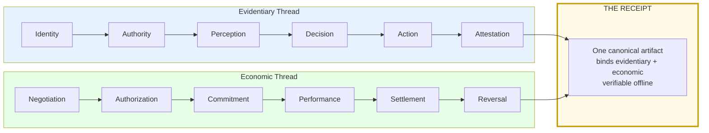

**Figure 2 — The Receipt as the Joint of Two Orthogonal Threads**

*The receipt is not the record of action; it is the record of action AND its economic consequence, bound into one artifact. The evidentiary thread answers "what happened?"; the economic thread answers "what did it commit?"; the receipt is the unique 2D point where both threads cross.*
