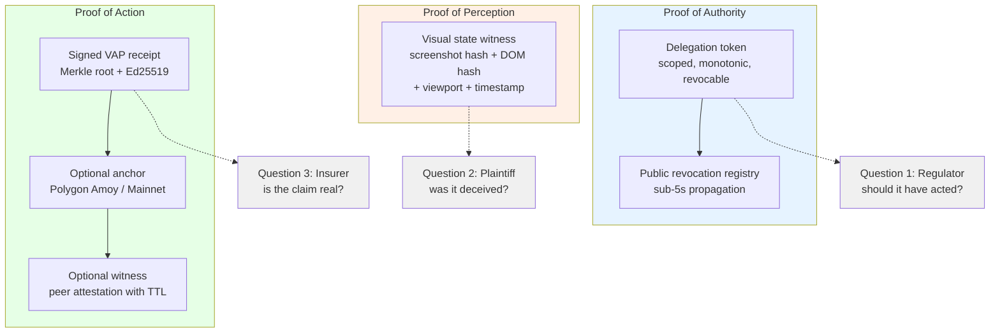

**Figure 3 — The Evidence Trinity**

*The three artifacts map one-to-one onto the three underwriter questions from Section 3. Authority tells the regulator whether the agent should have acted; perception tells the plaintiff whether the agent was deceived; action tells the insurer whether the claim is real.*
