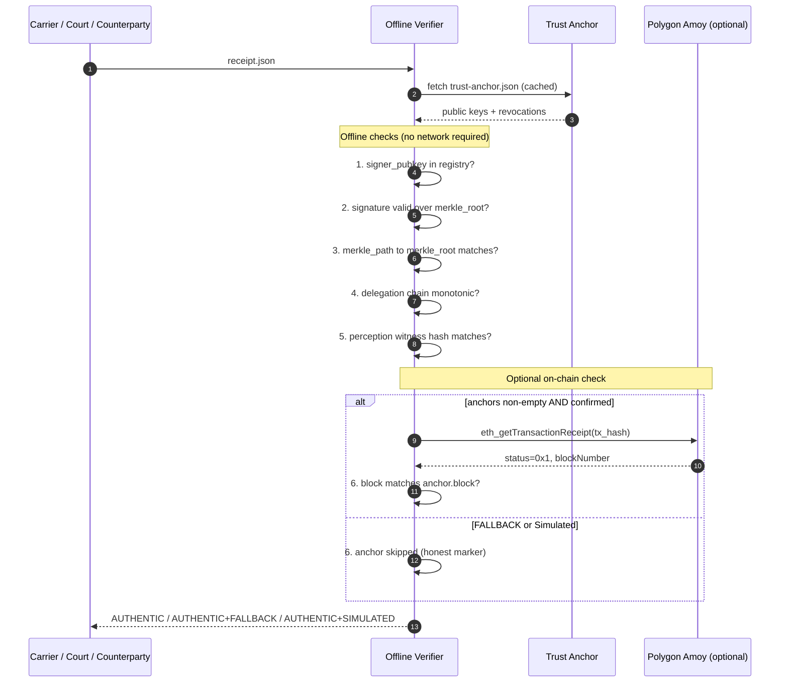

**Figure 5 — The Verification Flow (Third-Party, Offline)**

*Checks 1 through 5 run offline from the receipt bytes and one cached trust anchor. The chain lookup (check 6) is optional — it adds "this record existed by block N" but is not required for authenticity. This is the architectural difference from chain-required evidence systems.*
