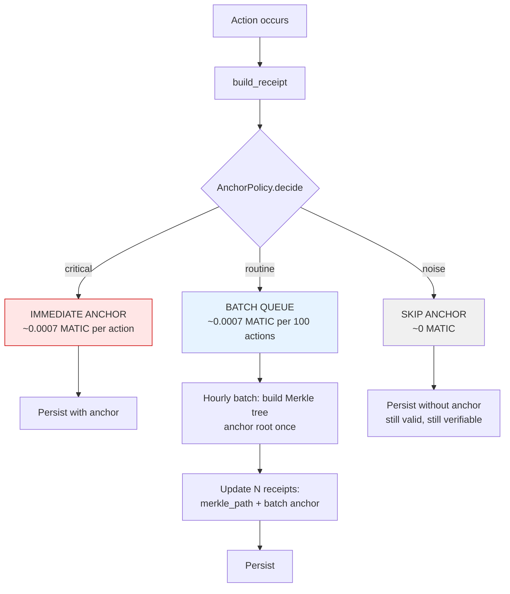

**Figure 6 — The Anchoring Decision Tree**

*Critical actions (financial transfers, wire transfers, contract creation, payment settlement, risk tier 3+, BLOCK, HITL, high novelty, cross-org, disputed, claimed) anchor immediately. Routine actions (reads, monitoring, memory writes, allow verdicts at tier 1-2) enter a batch queue. Noise actions (retries, health checks, internal loops) skip anchoring — the receipt is still valid, still verifiable offline. For a 10,000-action/day agent, this reduces daily anchoring cost from ~$4/day to ~$0.01/day while critical actions still anchor in real time.*
