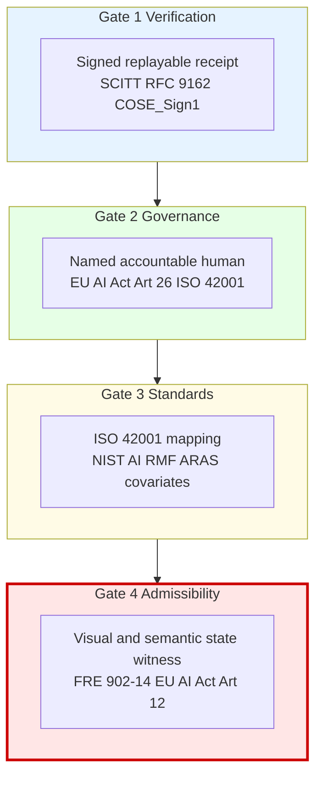
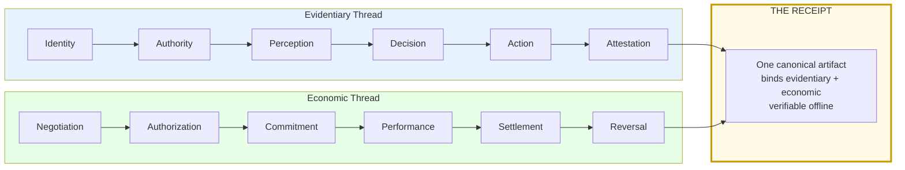
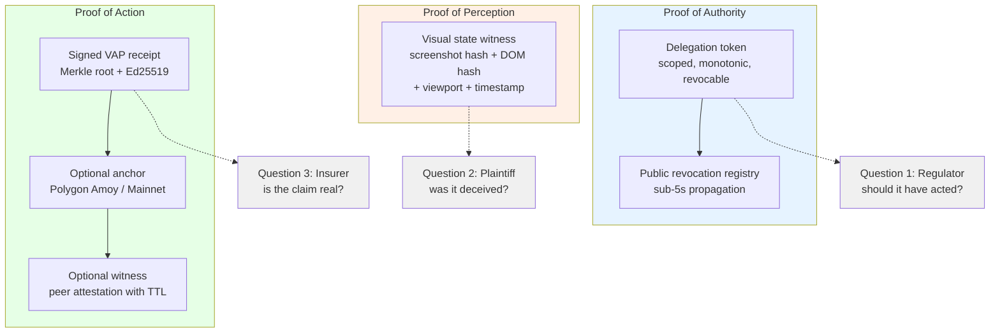
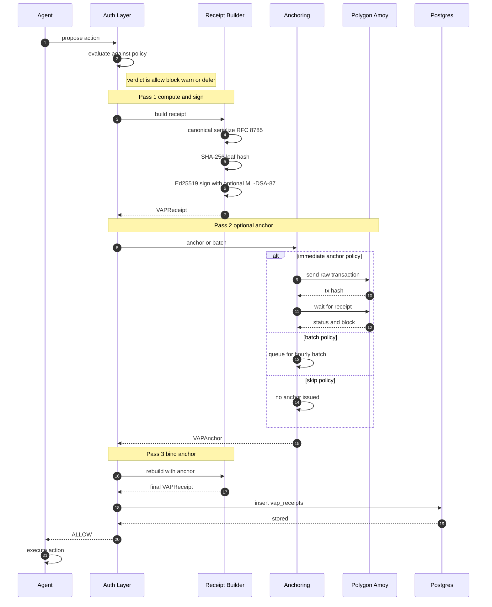
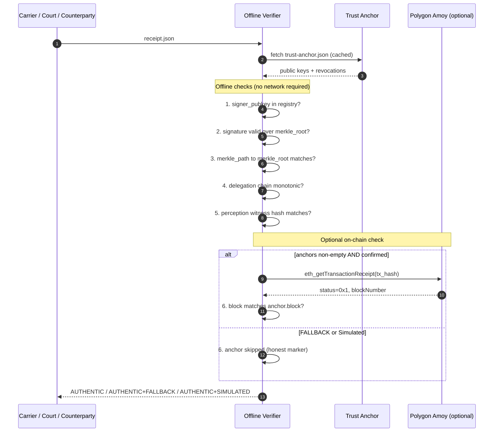
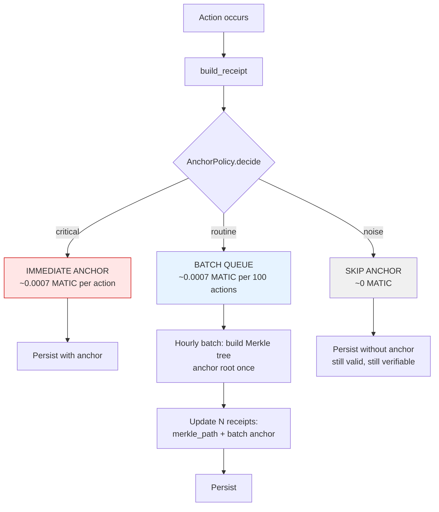

# How to Insure an AI Agent

### The Evidence Layer for Agentic Risk

**Subtitle:** Why agentic liability is an evidence problem, what underwriters actually require, and the four-gate architecture that closes the gap

---

**Status:** Public draft — version 1.0.0
**Date:** November 2026
**Author:** Rajinder Jhol
**Version:** 1.0.0
**Reading time:** ~60 minutes
**DOI:** *(to be assigned at Zenodo deposit)*
**License:** CC BY 4.0
**Companion documents:**
- [ANCHORING_EVIDENCE.md](../ANCHORING_EVIDENCE.md) — technical record of the anchoring primitive
- [COMMERCIAL_WORKFLOWS.md](../COMMERCIAL_WORKFLOWS.md) — the five buyer-facing workflows
- [TRUST_SERVICE_STRATEGY.md](../TRUST_SERVICE_STRATEGY.md) — strategic architecture
- [ARAS v1.0](../standards/ARAS-v1.0/) — Agentic Risk Assessment Standard
- [FRONTIER_AI_CONTROL_PLANE_PROPOSAL.md](../FRONTIER_AI_CONTROL_PLANE_PROPOSAL.md) — technical control plane

**Audience:** Underwriters, MGAs, brokers, risk officers, CISOs, general counsels, compliance leads, patent counsel, standards bodies, enterprise CFOs

**Status legend — maturity of each claim**

This paper distinguishes three levels of maturity. Every claim about the architecture, the evidence, or the market should be read against this legend.

| Marker | Meaning | What you can rely on |
|---|---|---|
| **[IMPLEMENTED]** | Code exists in the reference implementation, has been exercised end-to-end, and produces the evidence cited in Section 8. | You can run it today. |
| **[SPECIFIED]** | The format, protocol, or architectural element is fully specified, with a conformance test or a reference implementation, but has not been exercised at scale in production. | You can implement it. |
| **[PROPOSED]** | The element is a design intention or a market hypothesis. No implementation, conformance test, or production evidence yet exists. | You can critique it, fund it, or adopt it early. |

Where the paper does not attach a marker, the default is [SPECIFIED] — the element is part of the architecture the paper argues for, not a claim that it exists in production everywhere. The one exception is the anchoring evidence in Section 8 and in the companion document `ANCHORING_EVIDENCE.md`, which is [IMPLEMENTED] with confirmed on-chain transactions. Section 9 enumerates what the paper does not claim.

---

## Abstract

In 2026, liability for autonomous AI agents has concentrated on the deploying enterprise. Insurers are repricing to reflect that concentration. But the evidence required to underwrite — and later defend — that liability does not exist in most enterprises. Standard technology contracts allocate the risk to the customer while giving the customer no contractual right to the vendor's decision logs. Regulators now require record-keeping that internal logs cannot satisfy. Courts have explicitly declined to set a new regime, leaving the deployer to prove facts in a system they do not control.

This paper names the resulting gap as an **evidence problem**, not a legal one. It proposes a four-gate architecture — verification, governance, standards, and **admissibility** — in which the fourth gate is the decisive one for the current liability wave. It argues that the correct atomic unit of agentic risk is not the log, not the transaction, and not the audit trail, but the **signed, portable receipt** — a cryptographic artifact that binds what the agent was authorized to do, what it perceived, what it decided, and what it executed, in a form that any third party can verify offline. It then specifies how that receipt is anchored, how it is measured (ARAS covariates), and how it maps to five commercial workflows (insurance claims, regulatory filing, multi-party disputes, court evidence, attribution). It closes with a conformance path, an honest accounting of what is and is not yet claimed, and a call to carriers, enterprises, and standards bodies.

The thesis in one sentence: **the party who is liable is the party who cannot prove — and the party who can prove is now the party that gets insured.**

---

## How to read this paper

The paper is written for readers with different responsibilities. The sections below are not a substitute for reading the whole argument, but they identify the shortest path for each reader.

| Reader | Shortest path | What you will find |
|---|---|---|
| **CEO / Board** | Abstract, §1, §2, §11 | Why liability has concentrated on the deployer, and why evidence is the gap |
| **CFO / CRO** | §2, §3, §6, §10, §11 | The financial exposure, the five board questions, the conformance path |
| **Insurance underwriter** | §2, §3, §4, §5, §7, Appendix A | What the evidence is, how it maps to underwriting covariates, and what the market has already claimed |
| **MGA / broker** | §2, §6, §7, §11 | The five commercial workflows and the readiness of each |
| **CISO / CTO** | §4, §5, §8, Appendix B | The architecture, the receipt schema, and the offline verification flow |
| **General counsel** | §1, §2, §3, §4, §8, §9, Appendix D | The liability framing, the evidentiary distinction, and what the paper does **not** claim |
| **Compliance / AI governance** | §4, §5, §8, §10, Appendix D | The regulatory mapping and the conformance path |
| **Regulator / standards body** | §4, §5, §8, §9, Appendices A–E | The requirement, the specification, and the honest disclosure of what is and is not claimed |
| **AI developer / platform engineer** | §5, §8, Appendix B | The receipt format and the implementation |
| **Investor / strategic partner** | Abstract, §2, §6, §7, §10, §11 | The market, the workflows, and the conformance path |

The paper's longest single argument is §7 (The Landscape), which maps what each category of player has published and what each has left open. The paper's most important section for skeptical readers is §9 (What We Do Not Claim), which establishes the boundaries around what the architecture can actually demonstrate. The paper's most concrete evidence is §8 and the companion `ANCHORING_EVIDENCE.md`.

## 1. The Scene

The title of this paper promises a method for insuring AI agents. The argument it actually makes is narrower and more useful: the missing infrastructure between AI governance and AI liability is an *evidence layer* — a set of artifacts that make autonomous actions independently verifiable, and therefore insurable. Whether an insurer ultimately binds a policy, an enterprise reduces premium, or a court admits a receipt is a downstream question. The upstream question — the one this paper addresses — is whether the enterprise can produce evidence at all.

Consider a composite incident, constructed from three real filings we have reviewed and one advisory opinion we have read. The details are synthetic; the pattern is not.

An enterprise deploys an autonomous procurement agent. The agent is authorized to negotiate with supplier agents, choose among vetted vendors, and approve payments up to a delegated threshold. It operates continuously. On a Tuesday morning it approves a payment of $180,000 to a supplier whose invoice displays $18,000 on the agent's rendered interface. The invoice PDF that was attached to the email was correct; the checkout page the agent clicked through on the supplier's portal was not. This distinction — between what the invoice said and what the checkout page displayed — is the entire case.

The payment settles. Three weeks later, during quarterly audit, the discrepancy is discovered. The enterprise opens an investigation.

Four parties speak, in order:

**The regulator.** Under EU AI Act Article 26, the enterprise is the deployer and bears the deployer's obligations — human oversight assignment, six-month log retention, incident reporting. Under the UK CMA's March 2026 ruling, the enterprise — not the model vendor, not the framework vendor, not the portal operator — is responsible for what the agent does to consumers and counterparties. The enterprise is liable.

**The contract.** The enterprise's contracts with its agent vendor allocate autonomous-action risk to the enterprise, extend an "as is" disclaimer to decisions the agent makes within the scope of its authority, and — critically — do not grant the enterprise any right to the vendor's decision logs, real-time suspension mechanisms, or cooperation during regulatory investigations. The enterprise is liable, and the enterprise is contractually naked.

**The court.** Under the Ninth Circuit's August 2026 ruling in *Amazon v. Perplexity*, the agent "is a tool, not a person for statutory purposes." The court declined to set a new legal regime for agentic AI. The enterprise cannot plead the agent as a co-defendant. The enterprise is liable, and the enterprise cannot appeal to a special regime.

**The insurer.** Under the enterprise's current E&O policy, generative AI and agentic decisions are excluded or ambiguous. Under the enterprise's D&O policy, third-party liability arising from autonomous software is not clearly covered. When the enterprise approaches the market for a rider, the first underwriter question is not "what was the agent authorized to do?" It is "can you prove what the agent saw at the moment it clicked?"

The enterprise cannot answer that question.

---

The three sentences that land simultaneously at this moment are:

1. **The party who is liable is the party who cannot prove.**
2. **The party who controls the evidence is the party who is not liable.**
3. **The party who is insured is the party who can prove.**

This inversion is the entire agentic liability problem. It is not a legal problem, because the law has already decided who pays. It is not a technical problem, because the cryptography to solve it has existed for years. It is not even a vendor problem, because vendors have correctly protected their own interests. It is an **evidence problem**: the party bearing the risk has no infrastructure to produce the evidence the risk requires.

The rest of this paper is about that infrastructure.

---

## 2. The Inversion

### 2.1 Liability has concentrated on the deployer

Between March 2026 and November 2026, four independent regimes converged on the same actor:

| Authority | Date | Holding |
|---|---|---|
| **UK Competition & Markets Authority** | 9 March 2026 | The business *deploying* the agent bears responsibility for what it says and does to consumers; fines up to 10% of global turnover under the DMCCA without prior court action. |
| **EU AI Act Article 26** | Phase 1 in force Feb 2025, deployer obligations phased through Aug 2027 | Deployers must assign human oversight, retain automatically generated logs for at least six months, and report serious incidents; penalties up to €15M or 3% of global revenue. |
| **Ninth Circuit (*Amazon v. Perplexity*)** | 4 August 2026 | The agent is "a tool, not a person for statutory purposes"; CFAA/CDAFA claims failed because no "access" occurred. The court expressly declined to establish a new legal regime for agentic AI. |
| **US state AG coalition** | December 2025 | A bipartisan 42-state coalition, with no federal pre-emption, using UDAP, consumer protection, civil rights, and antitrust authority as de facto national liability standards. |

The consistency is not a coincidence. It reflects a shared legal instinct: **that the party who chose to deploy the agent, and who has the operational capacity to control it, is the party who should bear its consequences.** This is the same instinct that has governed product liability, workplace safety, and financial services for a century. It is not going to change.

The consequence, for the enterprise, is precise: **deployer liability is not a risk to be managed at the margins of contract negotiation. It is the enterprise's own risk, on its own books, at full weight.**

### 2.2 Evidence has not concentrated on the deployer

Where the deployer has gained liability, it has not gained evidence. This is not a technical oversight. It is a structural feature of how AI vendors have architected their products.

The evidence of an agent's action lives, in most deployments, in four places the deployer does not fully control:

| Evidence type | Where it lives | Deployer's access |
|---|---|---|
| Model inputs/outputs | Vendor's API logs | Subject to vendor's retention, may be deleted; no contractual right to full logs |
| Tool calls / API requests | The tool providers (OpenAI, Anthropic, third-party APIs) | Split across vendors; no unified record |
| Session context / memory | Vendor's compute, in ephemeral memory | No persistence guarantee |
| Decision reasoning | Often not logged at all | Not available |
| The rendered user interface the agent saw | The agent's own screenshot buffer, if any | Not retained by default |

The Clifford Chance advisory in February 2026 made the point directly: standard technology contracts allocate agentic risk almost entirely to the customer — while giving the customer no right to the evidence of the agent's actions. *"The liable party must own the enforcement layer and its records, independent of any single agent vendor."*

The party who is liable is the party who cannot prove.

### 2.3 The evidence gap is not a technical problem — it is a format problem

The cryptographic primitives needed to close this gap are not new. Ed25519 has been a standard since 2015. Merkle trees date to 1979. Public chain anchoring has existed since Bitcoin (2009) and Certificate Transparency (2013). What is missing is not the primitive — it is the **format** in which the primitive is packaged, so that:

1. The evidence is produced at the moment of action
2. The evidence travels with the action
3. The evidence is legible to every downstream consumer (carrier, court, regulator, counterparty)
4. The evidence is verifiable offline — without trusting the enterprise, the vendor, or anyone else
5. The evidence is honest about its own state (confirmed, attempted-but-failed, or deliberately not attempted)

This is a **format specification problem**, and no incumbent has solved it. As the AgencyLiability.eu working paper of 2026 put it: *"the record most insureds can produce is the vendor's own log — testimony, not evidence."*

### 2.4 What this means for the market

The market has already spoken. Insurers have entered. They are not waiting for a legal regime that establishes liability; the regimes have done that. They are waiting for **evidence they can underwrite against**.

| Carrier / MGA | What they have done | What they require |
|---|---|---|
| **Armilla** (Lloyd's coverholder) | Affirmative AI liability product, expanded to $25M+ per organization by early 2026 | Bind on "independent AI system assessment"; empirical evidence, not attestation |
| **Testudo** | Underwrites affirmative AI coverage | Underwrites only on documented governance evidence |
| **Munich Re / Mosaic** | Ranks AI as leading cyber challenge with accumulation potential in tens of billions | Parameters under active review |
| **Mount** (YC, Altman-backed) | Purpose-built AI-agent liability carrier | Requires deployment verification |
| **Klaimee** ($5.5M seed) | "Insurance-backed performance warranties for AI agents" | Real-time behavioral evidence |
| **Harbor** ($10M seed) | Risk platform + insurance, working with banks and regulated companies | Verifiable operational controls |

The market has not settled the pricing model yet. It has settled **the direction of the question**: underwriters will bind on evidence, not on attestation. The gap between the two is precisely what this paper calls the evidence layer.

### 2.5 The one-sentence reframe

**Agentic liability is not a legal exposure to be transferred, but an evidence gap to be closed.**

The rest of this paper is a specification of what closing that gap requires, and how the enterprises that close it first will access coverage the rest of the market cannot.

---

## 3. The Three Questions

Across the underwriting literature, the standards documents, and the consulting reports cited in the Acknowledgments, the questions underwriters ask about agentic risk collapse to three. They appear in the following order, and they appear whether or not the underwriting conversation began as one about AI.

### Question 1 — Proof of authority

> *"Can you prove what the agent was authorized to do?"*

This is the regulator's first question after an incident. It is also the underwriter's first question at policy inception. It has three parts, and each part has a technical answer:

- **Scope**: what was the agent permitted to do, expressed as a capability set, a spend limit, a contract type, or a jurisdiction scope?
- **Delegation**: who delegated that authority to the agent, in what chain, with what attenuations along the way?
- **Revocation**: how is the authority revoked if the agent goes rogue, and how quickly can the revocation propagate across every system the agent can reach?

An enterprise that cannot answer all three does not have governance. It has policy documents. The distinction is not semantic: a policy document that cannot be enforced is not a control, and a control that cannot be proven is not evidence.

### Question 2 — Proof of perception

> *"Can you prove what the agent saw at the moment of action?"*

This is the plaintiff's first question in a dark-pattern dispute, and it is the question that separates an insurable enterprise from an uninsurable one in 2026. It is also the question that most AI governance platforms do not answer, because they were designed to capture model output, not model *input*.

The distinction matters because:

- A semantic log tells you what the model **output**. It does not tell you what the rendered user interface **displayed** to the agent when it acted.
- A prompt record tells you what the API **received**. It does not tell you how the browser **rendered** the response.
- A trace capture tells you the **tool call**. It does not tell you the **visual context** in which the agent decided to invoke that tool.

The failure mode these three logs miss is the one that appears most frequently in the current liability wave: **a dark-pattern interface that deceived the agent**. If a checkout page displays $18,000 to the human and $180,000 to the agent's browser, only a **visual capture** can prove it. No semantic log can.

### Question 3 — Proof of action

> *"Can you prove what the agent did, and that the record has not been altered since?"*

This is the insurer's first question at claims time. It is the easiest of the three to answer technically — signed logs have been a solved problem for a decade — and the hardest to answer contractually, because the enterprise that needs to prove the action is usually not the enterprise that holds the record.

The three sub-questions the underwriter actually asks:

- **Attribution**: was this specific agent, acting under this specific delegation, responsible for this specific action?
- **Integrity**: has the record been altered since the moment of action?
- **Independence**: can a third party verify the record without the enterprise's cooperation?

An enterprise that can answer attribution but not integrity has logs. An enterprise that can answer attribution and integrity but not independence has *testimony*. Only an enterprise that can answer all three has *evidence*.

### The three questions in one sentence

**Proof of authority tells the regulator whether the agent should have acted; proof of perception tells the plaintiff whether the agent was deceived; proof of action tells the insurer whether the claim is real.**

The enterprise that can answer all three becomes insurable at a price the market will pay. The enterprise that cannot becomes a liability the market prices in and then excludes.

---

## 4. The Four Gates

Most agentic risk frameworks in 2026 name three gates: **verification**, **governance**, and **standards**. This is the right structure, but it is incomplete. There is a fourth gate, and in the current liability wave it is the decisive one.

We call it the **admissibility gate**, and it is the gate that closes dark-pattern disputes, mispricing disputes, and any dispute where the question is not "what did the agent do?" but "what did the agent *see*?"

### 4.1 Gate 1 — Verification

> *"Can you prove what it did?"*

**The artifact:** a signed, replayable receipt that binds the action's canonical form, the decision that produced it, and the delegation under which it occurred.

**The standard:** SCITT (Supply Chain Integrity, Transparency, and Trust, IETF), RFC 9162 (Certificate Transparency), COSE_Sign1 (RFC 9052).

**What it does not prove:** whether the action was *correct*. Verification answers the fact of the action; correctness is a separate question.

**What most enterprises have:** a log file. Sometimes a structured log. Rarely a signed receipt.

### 4.2 Gate 2 — Governance

> *"Who was on watch?"*

**The artifact:** an oversight register that names a specific human — not an organization, not a team, not an on-call rotation — who is accountable for the agent's behavior, bound to the receipt by a cryptographic chain.

**The standard:** EU AI Act Article 26(2) oversight assignment; ISO/IEC 42001 management system; the accountability-chain patterns formalized in *AGENTIC_PHILOSOPHY_AND_SOUL.md* §4.

**What it does not prove:** whether the human was *paying attention*. Governance answers the fact of assignment; attention is a separate question, often answered by the HITL audit trail.

**What most enterprises have:** a policy document that says "the AI Risk Committee is responsible." This is not governance. It is documentation.

### 4.3 Gate 3 — Standards

> *"Against what yardstick?"*

**The artifact:** a mapping from the enterprise's controls to a published standard — ISO/IEC 42001, NIST AI RMF, OWASP Top 10 for Agentic Applications, or the Agentic Risk Assessment Standard (ARAS) published by the authors of this paper.

**The standard:** ISO/IEC 42001 Annex A; NIST AI RMF GOVERN/MAP/MEASURE/MANAGE; ARAS v1.0 for underwriter-facing risk scoring.

**What it does not prove:** whether the standard itself is adequate. Standards answer the question of comparability; adequacy is a separate question, often answered by the reinsurer or the regulator.

**What most enterprises have:** a self-assessment against a checklist. This is not conformance. It is aspiration.

### 4.4 Gate 4 — Admissibility

> *"Can you prove what the agent **saw**?"*

**The artifact:** a visual-state witness — a hash of the rendered screenshot, a hash of the DOM snapshot, the viewport geometry, and the timestamp, all bound into the same receipt that records the semantic action.

**The standard:** Federal Rules of Evidence 902(14) (self-authenticating electronic records); EU AI Act Article 12 (record-keeping); and the evidentiary standards of every jurisdiction that has recently taken up agentic liability.

**What it does not prove:** whether the interface was *fair*. Admissibility answers the fact of perception; fairness is a separate question, often answered by the substantive dispute.

**What most enterprises have:** nothing. This is the gate that is currently missing from the market, and it is the gate that the current liability wave is most concerned with.

### 4.5 Why the fourth gate is decisive

The three-gate model tells an enterprise whether it *governed* the agent. The fourth gate tells the enterprise whether the agent was *deceived*.

The distinction is not academic. The most common failure modes in agentic AI in 2026 are not agent failures in the traditional sense. They are:

1. **Dark-pattern UI deception** — the agent is shown a misleading interface and acts on it
2. **Mispricing** — the agent sees one price on the checkout page and another in the final transaction
3. **Prompt injection through UI** — a hidden element in a rendered page attempts to redirect the agent
4. **Contract drift** — the terms displayed differ from the terms recorded
5. **Attribution confusion** — a downstream system attributes an action to an agent that did not perform it

Every one of these failure modes requires **proof of what the agent saw**, not just proof of what the agent did. An enterprise that has only semantic logs is defenseless against all five.

The fourth gate is the gate that turns the enterprise from a **deployer with logs** into a **deployer with evidence**. It is the gate that makes the enterprise insurable at a price the market will accept.

### 4.6 The four gates, summarized

**Figure 1 — The Four Gates**

*The four gates are cumulative. Verification without governance is incomplete; governance without standards is incomparable; standards without admissibility is undefendable. The fourth gate (admissibility) is the one currently missing from the market and the one the current liability wave is most concerned with.

| Gate | Question | Artifact | Failure mode if missing |
|---|---|---|---|
| **1. Verification** | Can you prove what it did? | Signed, replayable receipt | Log testimony, not evidence |
| **2. Governance** | Who was on watch? | Named accountable human, cryptographically bound | "The AI Risk Committee is responsible" |
| **3. Standards** | Against what yardstick? | ISO 42001 mapping, ARAS covariates | Self-assessment vs. self-assessment |
| **4. Admissibility** | Can you prove what it **saw**? | Visual + semantic state at action time | Defenseless against dark-pattern disputes |

The four gates are cumulative: verification without governance is incomplete; governance without standards is incomparable; standards without admissibility is undefendable. Only the enterprise that closes all four is **insurable, defensible, and boundable** — the three words in the current positioning that this paper argues are the three words that matter.

---

## 5. The Evidence Trinity

**Figure 2 — The Receipt as the Joint of Two Orthogonal Threads**

*The receipt is not the record of action; it is the record of action AND its economic consequence, bound into one artifact. The evidentiary thread answers "what happened?"; the economic thread answers "what did it commit?"; the receipt is the unique 2D point where both threads cross.*

**Figure 3 — The Evidence Trinity**

*The three artifacts map one-to-one onto the three underwriter questions from Section 3. Authority tells the regulator whether the agent should have acted; perception tells the plaintiff whether the agent was deceived; action tells the insurer whether the claim is real.*

The four gates describe what an enterprise must prove. The **evidence trinity** describes how the enterprise proves it — with three artifacts that map one-to-one onto the three underwriter questions in Section 3.

### 5.1 Proof of Authority

**What it is:** a signed, attenuable delegation token that travels with every action, together with a public revocation registry that a third party can query without the delegator's cooperation.

**The artifact:** a token whose cryptographic invariants guarantee:

- **Scoped authority** — the token carries a spend limit, a capability set, a contract type, a jurisdiction scope, and a time bound, all as signed claims
- **Monotonic delegation** — any child token issued under a parent token provably has a *subset* of the parent's authority, enforced at validation time, not just at issuance
- **Revocation** — a sub-five-second revocation registry that propagates across a mesh, publicly discoverable at a well-known URL

**What it proves:** at the moment of action, this specific agent held this specific authority, delegated from this specific principal, and that authority had not been revoked.

**What it does not prove:** whether the delegator was *correct* to grant the authority. Correctness is a substantive question for the delegating organization, not an evidentiary question for the verifier.

### 5.2 Proof of Perception

**What it is:** a visual-state witness — a cryptographic commitment to what the agent's interface actually displayed at the moment the action was taken.

**The artifact:** a Merkle leaf that commits to:

- The hash of the rendered screenshot
- The hash of the DOM snapshot
- The viewport geometry and scroll position
- The timestamp of the render
- The rendered accessibility tree, where available

**What it proves:** at the moment of action, this specific agent was shown this specific interface — verifiable from the receipt bytes alone, without trusting the enterprise's screenshot buffer or the vendor's telemetry.

**What it does not prove:** whether the interface was *misleading*. Fairness is a substantive question for the court. The witness answers the evidentiary question — what was shown — so that the substantive question can be litigated on the facts rather than on the logs.

### 5.3 Proof of Action and Witness

**What it is:** the signed VAP receipt — the artifact that binds the action, the decision, the delegation, and (in the optimal form) the perception — into a single portable record, optionally anchored to a public chain.

**The artifact:** a receipt containing:

- The action's canonical form and SHA-256 hash
- The decision verdict and rationale
- The delegation token ID (per Section 5.1)
- The perception leaf hash (per Section 5.2)
- The signature over the hash (Ed25519, optionally post-quantum ML-DSA-87)
- The anchor — optional, a Merkle root posted to Polygon or another public chain, with a three-state marker that distinguishes **confirmed** / **attempted-but-failed** / **deliberately not attempted**
- The witness — an optional second-party attestation with a TTL, a confidence score, and a DID-linked identity, for high-risk actions

**What it proves:** the action occurred, at this timestamp, under this authority, with this perception, and the record has not been altered since.

**What it does not prove:** whether the action was *wise*. Prudence is a substantive question. The receipt makes the substantive question legible, but it does not answer it.

### 5.4 The three artifacts in one sentence

**Authority tells the regulator whether the agent should have acted; perception tells the plaintiff whether the agent was deceived; action tells the insurer whether the claim is real.**

An enterprise with only one of the three has a partial defense. An enterprise with all three has a complete defense — and a claim that a carrier can price without ambiguity.

---

## 6. The Five Commercial Workflows

The evidence trinity is not a research curiosity. It maps onto five commercial workflows that already exist in the market. Each workflow uses a different subset of the trinity; each workflow has a different buyer; each workflow is at a different stage of readiness. **[SPECIFIED]** — the workflows are designed against market participants' published requirements, but no carrier or counterparty has yet accepted a receipt under any of them. The readiness figures in each subsection are estimates of engineering and commercial effort, not of adoption.

Full detail is in `COMMERCIAL_WORKFLOWS.md`; the summary here positions the workflows within the paper's argument.

### 6.1 Workflow 1 — Insurance claims

**What it is:** an enterprise that has deployed agents files a claim with its AI liability carrier. The carrier requests evidence that the incident occurred as described, that the record is authentic, and that the record existed at the time of the incident. The enterprise produces the receipt; the carrier verifies it offline; the claim settles.

**What anchoring does:** turns a claim from a negotiation into a verification. Time-to-payout goes from weeks to hours.

**Who pays:** the carrier (percentage of premium for verified-evidence tier), the enterprise (per-claim verification fee), or both.

**Readiness: 30 days.** The code exists; the missing piece is a carrier willing to accept anchored receipts as claim evidence.

**Why it matters for the paper's argument:** this is the workflow where evidence converts most directly to money, and it is the workflow that proves the market thesis in Section 2.4 — that underwriters bind on evidence, not on attestation.

### 6.2 Workflow 2 — Regulatory filing

**What it is:** a regulated enterprise files a quarterly or per-incident report with a regulator (EU AI Office, Singapore IMDA, a state AG). The filing includes a dossier of the agent's actions, each anchored and independently verifiable.

**What anchoring does:** removes the "trust me" step from regulatory compliance. The regulator verifies each record independently, without the enterprise's cooperation.

**Who pays:** the enterprise (compliance product subscription, priced by filing frequency or per-agent); recurring revenue.

**Readiness: 45 days.** The Annex G dossier generation exists; the missing piece is a packaging layer that includes anchored receipts automatically.

**Why it matters for the paper's argument:** this is the workflow that creates recurring revenue from the evidence layer, and it is the workflow where the EU AI Act's Article 26(6) six-month log retention requirement is most directly addressable — anchored receipts satisfy the spirit of the retention requirement, because the receipt is self-contained and does not depend on the enterprise's database.

### 6.3 Workflow 3 — Multi-party agent commerce disputes

**What it is:** two agent operators transact; something goes wrong; both submit receipts to a neutral arbiter; the arbiter verifies both offline and compares. The dispute resolves on the anchored facts.

**What anchoring does:** eliminates the "who is lying" question. The only remaining question is what the contract required — which is a legal question with a settled answer. Time-to-resolution goes from 6–18 months to 48 hours.

**Who pays:** percentage of escrow (typical arbitration fee: 1–5%), fixed arbitration fee per dispute, or per-transaction verification fee.

**Readiness: 90 days.** The escrow and receipts exist; the missing piece is a UI for submitting disputes and a decision flow.

**Why it matters for the paper's argument:** this is the workflow that creates the network effect. Every arbitration becomes a standards advertisement, and every new participant wants their receipts on the same format so they can participate.

### 6.4 Workflow 4 — Court evidence

**What it is:** an AI agent makes a decision that causes harm; the defendant produces the signed receipt; the plaintiff's expert verifies it; the receipt settles the evidentiary question and the court focuses on the substantive question.

**What anchoring does:** the receipt existed before the lawsuit was filed (cannot be manufactured) and the receipt is verifiable without trusting the defendant (cannot be falsified).

**Who pays:** per-receipt licensing to law firms and expert witnesses; small volume, high margin.

**Readiness: 120 days.** The evidence exists; the missing piece is an FRE 902(14) expert witness willing to testify to admissibility, and one precedent-setting case.

**Why it matters for the paper's argument:** this is the workflow that establishes the legal precedent the entire category depends on. It is the workflow most likely to be litigated, and therefore the workflow most likely to establish that anchored receipts are admissible as evidence of existence.

### 6.5 Workflow 5 — Attribution and licensing

**What it is:** a content publisher exposes a quote endpoint; an agent fetches a quote, pays, and receives content; the transaction produces a receipt that proves the publisher and the agent transacted at a specific price.

**What anchoring does:** makes pay-per-crawl auditable. Both sides can prove the transaction happened, so the "agent scraped 10,000 articles and the platform cannot prove it" dispute disappears.

**Who pays:** percentage of quotes, split with publisher.

**Readiness: 6+ months.** Depends on the QuoteEngine (the C7 claim in the patent strategy), which is not yet built.

**Why it matters for the paper's argument:** this is the workflow that closes the loop between agentic commerce and agentic evidence. It is the workflow that will become most important once the market matures past the current liability wave, but it is not the workflow that will fund the current one.

### 6.6 The five workflows in one sentence

**Insurance claims, regulatory filings, multi-party disputes, court evidence, and attribution licensing** — each uses a different subset of the evidence trinity, each has a different buyer, and each is at a different readiness. The first two are near-term; the last three are strategic bets. The category is not a single workflow; it is a set of workflows that all rest on the same evidence primitive.

### 6.7 Why this matters for the paper's argument

The five workflows demonstrate that **the evidence layer is not a single product — it is infrastructure for five different products.** The enterprise that has built the evidence layer does not have to choose one workflow; it can serve all five.

The enterprise that has not built the evidence layer must choose: it can buy one workflow from one vendor, and the receipt from that vendor will not be legible to the workflows served by the other vendors. This is the fragmentation the market currently exhibits, and it is the fragmentation that the standards-and-format approach in this paper is designed to close.

---

## 7. The Landscape

In 2026, the agentic-risk category has formed, but it is fragmented. Four categories of players are publishing on the same problem, each from a different angle, and none has published the unified evidence-layer specification that the workflows in Section 6 require.

Understanding what each category has claimed — and what each has left open — is prerequisite to understanding where the evidence layer fits.

### 7.1 Big tech: identity and control, but platform-bound evidence

| Player | What they have published | What they leave open |
|---|---|---|
| **Microsoft** | Entra Agent ID (GA Apr/May 2026); Agent 365 (GA May 2026); Responsible AI standard; "Humanist AI" code draft | Identity and lifecycle governance; the record is produced and held **inside Microsoft's plane** — no vendor-independent portability claim, no underwriting covariate set, no perception witness |
| **Google / DeepMind** | Intelligent AI Delegation (Feb 2026); AI Agent Traps (six attack categories, success rates up to 100%, "normative void open on legal responsibility"); Agentic Profile (Nature, Aug 2026); Securing the Future of AI Agents | The most rigorous **conceptual frameworks** for delegation and agent profiling; **no evidence artifact**. Delegation is a framework, not a receipt format |
| **IBM** | Agent Identity (GA Oct 2026); four-pillar operating model — discovery, verified identities, access controls, performance evaluation | Complete **enterprise identity lifecycle**; platform-scoped. Records are custodied, not portable |
| **AWS** | Agentic AI Governance Control Plane reference implementation; Earned Autonomy Maturity Model (May 2026); OWASP Agentic Top 10 mapping | A platform-neutral control plane **on AWS**; a maturity model describing *how governed* an agent is; no priced-risk covariate, no receipt schema, no perception layer |

**The shared limitation:** each has built the identity and control plane, but none has built the **portable evidence artifact** that a third party can verify without trusting the platform. The record is produced and held inside a hyperscaler's plane.

**The shared opening:** DeepMind itself names "a normative void open on legal responsibility." The most rigorous safety lab in the world acknowledges the gap this paper addresses and proposes no artifact to close it.

### 7.2 Consulting: frameworks, maturity models, and checklists, but no format

| Player | What they have published | What they leave open |
|---|---|---|
| **McKinsey** | State of AI Trust 2026 (n=500); agentic AI governance as a new fifth dimension; "action controls, not content controls"; 80% of organizations have encountered risky agent behavior; active mitigation lags risk awareness | The best **data** in the market; a maturity model, not an evidence format |
| **Deloitte** | Deloitte Legal report (June 2026) on legal accountability; State of AI 2026 — only one in five has a mature governance model for autonomous agents, 74% plan to deploy within two years | The **legal-accountability frame**; a **process** prescription, not an artifact |
| **PwC** | AI-CAL (AI Control Assurance Level) — six autonomy levels, graded assurance (with Trend Micro, July 2026) | The closest consulting analogue to a **measurement** standard; assurance level ≠ underwriting covariate |
| **Gartner** | 40% of enterprises will demote or decommission autonomous AI agents by 2027 due to governance gaps identified after production incidents; 70% will experience material incidents by 2029; 71% expect to deploy within 12 months, only 21% have governance | The **urgency and the segmentation**; not the artifact |
| **Forrester** | 4 of top 5 threats are AI governance failures; agentic intent as its own security domain; AEGIS controls baseline | Names **intent** as the missing domain; does not supply the intent record format |
| **KPMG** | *(Withdrew its own agentic AI report after named companies disputed the claimed achievements)* | The counterexample — the thesis demonstrated by negation |

**The shared limitation:** consulting has produced frameworks, maturity models, and checklists. It has not produced a **portable artifact**. A maturity model tells an enterprise how governed it is; it does not produce a record a carrier can price.

**The shared opening:** McKinsey's own data — that 80% of organizations have encountered risky behavior and mitigation lags awareness — is the demand signal. What consulting does not yet supply is the supply-side format.

### 7.3 Insurance: the market has already voted on the mechanism

| Carrier / MGA | Position | What they price on |
|---|---|---|
| **Armilla** (Lloyd's coverholder) | Affirmative AI liability, expanded to $25M+ per org by early 2026 | Binds on **independent AI system assessment**; empirical evidence, not attestation |
| **Testudo** | Affirmative AI coverage | Underwrites only on **documented governance evidence** |
| **Munich Re / Mosaic** | Leading cyber challenge, accumulation potential in tens of billions | Parameters under active review |
| **Mount** (YC, Altman-backed) | AI-agent liability carrier | **Deployment verification** |
| **Klaimee** ($5.5M seed) | Insurance-backed performance warranties | **Real-time behavioral evidence** |
| **Harbor** ($10M seed) | Risk platform + insurance for banks and regulated companies | **Verifiable operational controls** |
| **Berkley** | Absolute AI exclusion | Excluded — no coverage available |
| **Chubb, Travelers, Berkshire Hathaway, AIG, Great American** | Various exclusions in D&O, E&O, professional lines | Excluded — no coverage available |

**The market's own summary, from a 2026 working paper:** *"The underwriting gap of 2026 is, at bottom, an evidence gap."*

**The market's own corollary, from the same paper:** *"The line between insurable and uninsurable is becoming the ability to prove what your AI actually did."*

**The market's own observation on what enterprises produce:** *"The record most insureds can produce is the vendor's own log — testimony, not evidence."*

**The shared limitation:** the market has priced the mechanism — bind on evidence — but has not standardized the format. Every carrier that requires evidence today is effectively using a proprietary, bespoke evaluation, which means **portability between carriers is zero**. An enterprise that buys Armilla's evaluation does not automatically qualify for Testudo's. This is a **format problem**, not a risk-appetite problem.

### 7.4 Standards bodies: they name the requirement, not the artifact

| Body | What they require | What they specify |
|---|---|---|
| **NIST** (Nov 2026) | Ten design tenets for AI agent identity and authorization, including *"tamper-evident, append-only logs kept independent of the agent"* | The **requirement**; no format |
| **ISO/IEC 42001** | Annex A.6.2.8 — determine at which lifecycle phases event-log recording should be enabled for traceability and accountability | The **capability requirement**; no schema |
| **WEF** (April 2026) | "Governance must now be encoded, not discussed"; the **"architecture of constraint"**; "if you cannot explain how a decision was made, you cannot defend it" | The **philosophy**; no artifact |
| **OECD** | "Functional frameworks for real-time agentic oversight remain absent" | Names the **absence**; no proposal |
| **Brookings** (Oct 2026) | Governance must become **continuous**, with permissions scoped in advance, **traceable evidence**, and runtime monitoring | The **design principle**; no schema |

**The shared limitation:** standards bodies have named the requirement. NIST's phrasing — *"tamper-evident, append-only logs kept independent of the agent"* — is the paper's thesis almost verbatim. What standards bodies have not done is specify the format in which those logs must be produced, so that they are legible to every downstream consumer.

**The shared opening:** the format is available to adopt. Whoever specifies it, and demonstrates conformance to it, becomes the reference for the next decade of agentic-risk underwriting. The window is open for one or two years at most.

### 7.5 The one category nobody has claimed

Two things have happened simultaneously in 2026:

1. Every category named above has published **on the requirement**: identity (big tech), framework (consulting), pricing (insurance), standard (standards bodies).
2. No category has published the **format** — the concrete, portable, offline-verifiable artifact that satisfies the requirement, feeds the framework, prices the insurance, and conforms to the standard.

This is the gap. It is not a gap in any individual category's work. It is the gap **between** the categories. The identity plane does not produce the format. The framework does not produce the artifact. The pricing does not produce the data it prices. The standard does not produce the conformance test.

The evidence layer is the category that closes the gap. It is not a product — it is a **specification with conformance tests** that every category above can adopt.

---

## 8. What Good Evidence Looks Like in Production

The four gates and the evidence trinity are specifications. This section is a description of what those specifications produce when they run. **[IMPLEMENTED]** — every step below corresponds to code in the reference implementation, and the anchor evidence cited in Section 8 and in `ANCHORING_EVIDENCE.md` is confirmed on-chain.

### 8.1 The moment of action

**Figure 4 — The Receipt Lifecycle (Runtime)**

*The eight steps from action proposal to persisted receipt. Passes 1, 2, and 3 are the three build_receipt invocations discussed in Section 8.1. The anchor is optional: if the policy returns batch or skip, the receipt is still valid and still verifiable.

At the moment the agent acts, the following occurs:

**Step 1 — The action is proposed.**
The agent's framework produces a candidate action: an API call, a transaction, a document, a message.

**Step 2 — The Guardian evaluates the action against policy.**
The authorization layer — separate from the model, deterministic, cached — evaluates the action against:
- The delegation token's scope (spend limit, capability set, contract type, jurisdiction)
- The policy engine's rules (fail-closed by default)
- The novelty score (behavioral distance from the agent's recent history)
- The risk tier (a classification that determines HITL threshold)

The verdict is one of allow, block, warn, defer, attest_pass, attest_fail, or custom.

**Step 3 — The receipt is built (pass 1).**
The action is canonically serialized (RFC 8785 / JCS), hashed (SHA-256), and committed to a Merkle leaf. The leaf hash is the input to the signature.

**Step 4 — The perception witness is added.**
If the action was taken through a rendered interface, the visual-state witness is computed: screenshot hash, DOM snapshot hash, viewport geometry, timestamp. This is added to the receipt's evidence block.

**Step 5 — The receipt is signed.**
The Merkle root is signed with Ed25519, optionally with ML-DSA-87 (NIST FIPS 204) for post-quantum resistance.

**Step 6 — The anchor is produced (optional, policy-dependent).**
If the anchoring policy decides the action is immediate-anchor-worthy (financial transfers, wire transfers, contract creation, high risk tiers, blocks, HITL), the Merkle root is posted to Polygon Amoy or Mainnet. The transaction is waited on until confirmed. If the policy decides the action is batch-worthy, the leaf hash is queued for the batch worker. If the policy decides the action is noise (health checks, retries, internal loops), the receipt is issued without anchoring — still valid, still verifiable.

**Step 7 — The receipt is persisted.**
The receipt is stored in the enterprise's database. The stored row includes the full receipt JSON, the anchor marker, and — if the action was anchored — the tx hash and block number.

**Step 8 — The action executes.**
The single-use permit is verified by the execution gateway, the action is executed, and the receipt is associated with the outcome.

### 8.2 The verification flow

**Figure 5 — The Verification Flow (Third-Party, Offline)**

*Checks 1 through 5 run offline from the receipt bytes and one cached trust anchor. The chain lookup (check 6) is optional — it adds "this record existed by block N" but is not required for authenticity. This is the architectural difference from chain-required evidence systems.*

Any downstream consumer — a carrier, a court, a regulator, a counterparty — verifies the receipt independently:

**Step 1 — Fetch the trust anchor.**
The verifier fetches the enterprise's published trust anchor from a well-known URL (`/.well-known/verilink-trust-anchor.json`). The anchor contains the public keys and the revocation list.

**Step 2 — Verify the delegation chain.**
The verifier walks the delegation chain from the receipt's delegation token back to the root principal. Each hop's authority is checked for monotonicity: the child's spend limit and capability set are subsets of the parent's. The root's signature is checked against the trust anchor.

**Step 3 — Verify the signature.**
The verifier recomputes the leaf hash from the receipt's canonical form. The signature over the Merkle root is verified with the signer's public key from the trust anchor.

**Step 4 — Verify the Merkle path.**
The verifier walks the Merkle path from the leaf to the root. For a single-receipt tree, the path is trivial. For a batched tree, the path proves inclusion in the batch.

**Step 5 — Optionally verify the on-chain anchor.**
If the receipt has an anchor and the verifier wants to establish existence at a specific block, the verifier queries the chain for the transaction receipt. The `status: 0x1` and the `blockNumber` matching the anchor's block confirm the anchor.

**Step 6 — Verify the perception witness, if present.**
The verifier checks the visual-state hash against any screenshot the claimant provides. If the hash does not match, the perception is falsified.

**The entire flow runs offline except for Step 5.** Steps 1–4 and 6 require only the receipt bytes, the trust anchor, and (for Step 6) the claimed screenshot. A court can verify without access to the enterprise's database, the vendor's logs, or the platform's telemetry.

### 8.3 What the verifier outputs

The verifier produces a signed verification result. The result has three possible states:

| State | Meaning | What it enables |
|---|---|---|
| **AUTHENTIC, CONFIRMED** | The receipt is valid, the anchor is on-chain confirmed | Unconditional acceptance by carrier, court, regulator |
| **AUTHENTIC, FALLBACK** | The receipt is valid, the anchor was attempted but failed | Conditional acceptance; the verifier knows the chain was unreachable at the time of action |
| **AUTHENTIC, SIMULATED** | The receipt is valid, no anchor was attempted | Acceptance for audit, not for claim settlement; the enterprise opted out of on-chain notarization |

The three-state taxonomy is the receipt's own honesty about its anchor. It is not a failure of the verification; it is a property of the verification that makes the receipt more useful, not less, because it allows the verifier to distinguish "this record cannot be corroborated on-chain" from "this record has been tampered with."

### 8.4 The verification artifact the court receives

When a receipt is used as evidence in a court or regulatory proceeding, the packet consists of:

1. The receipt JSON — the signed artifact
2. The trust anchor — the published root of trust
3. The verification result — the signed output of the verifier
4. The on-chain proof — the Polygonscan URL, if the anchor is confirmed
5. The perception witness — the screenshot and DOM snapshot, if the dispute concerns what the agent saw

Every artifact is independently verifiable. None requires cooperation from the enterprise, the vendor, or the platform. This is the standard FRE 902(14) contemplates: a self-authenticating electronic record with a supporting hash and a reliable means of verification.

The court does not need to understand Polygon consensus, Ed25519 signatures, or Merkle trees. It needs an expert witness who can testify that the verification procedure is reliable — the same way it accepts DNA evidence, breathalyzer results, or GPS logs. The technical foundation is more rigorous than any of those; the evidentiary foundation is identical.

### 8.5 What the enterprise sees in the dashboard

The enterprise's compliance officer or risk officer sees, in a single view:

- **The receipt list** — sortable by action type, risk tier, verdict, anchor state
- **The verification state** — for each receipt, whether it has been verified externally and by whom
- **The anchor distribution** — how many receipts are confirmed, fallback, or simulated
- **The exception queue** — receipts that are blocked, deferred, HITL-required, or novel, sorted by severity
- **The coverage dashboard** — the enterprise's conformance to ARAS covariates, ISO 42001, NIST AI RMF
- **The carrier view** — a read-only view for the enterprise's underwriter, showing the same data aggregated at the level the carrier has contracted to see

The dashboard is not the evidence. It is the **interface** to the evidence. The evidence is the receipt, and the receipt is portable. The dashboard is how the enterprise monitors its own evidentiary posture.

---

## 9. What We Do Not Claim

A category-defining paper is credible only to the extent that it is honest about what it does not claim. This section is deliberately direct. If any of the following claims were made and were false, the credibility of the entire paper would collapse. They are not made.

### 9.1 What the evidence does not do

- **Evidence does not eliminate liability.** The party who is liable remains liable. The evidence changes the *proof* of liability, not its *existence*.
- **Evidence does not guarantee coverage.** An insurer will bind only on the combination of evidence and appetite. Evidence improves the position; it does not guarantee the outcome.
- **Evidence does not guarantee a lower premium.** An insurer may price the same risk more or less favorably based on evidence, but premium is a function of many factors, of which evidence is one.
- **Evidence does not transfer risk.** The deployer remains the deployer. There is no mechanism by which the receipt transfers liability to the vendor, the chain, or the standards body.

### 9.2 What the paper does not claim about the market

- **The paper does not claim that agentic risk is currently priced on evidence.** It claims that the direction of the market is toward pricing on evidence, and that the enterprises that produce evidence first will be better positioned when the pricing model settles.
- **The paper does not claim that the four-gate model is the only framing.** It claims that the four-gate model is the framing that closes the gap in the current liability wave, and that competing framings (three-gate, five-pillar) are complementary rather than contradictory.
- **The paper does not claim that any specific carrier, MGA, or broker has agreed to a specific pricing mechanism.** Carrier conversations are ongoing. The market is not yet priced.
- **The paper does not claim that the evidence layer is a completed product.** It claims that the evidence layer is a **specification with conformance tests** that can be adopted, implemented, and audited.

### 9.3 What the paper does not claim about the technology

- **The paper does not claim that anchoring is required.** The receipt is valid without an anchor. The anchor is supplementary. See Section 8.3 for the three-state taxonomy.
- **The paper does not claim that the on-chain anchor is a court admissibility requirement.** It claims that the anchor is a **self-authenticating mechanism** that is admissible under FRE 902(14) and its equivalents, and that its use is compatible with the evidentiary standards of the jurisdictions examined.
- **The paper does not claim that the perception witness is complete.** The perception witness captures what the agent's interface displayed. It does not capture the agent's internal model state, the model's training data, or the model's weights. These are separate questions, and the paper makes no claim about them.
- **The paper does not claim that the cryptographic primitives are novel.** Ed25519 is a 2015 standard. Merkle trees date to 1979. Post-quantum signatures date to 2016. The novelty of this paper is in the **format and the composition**, not in the primitives.

- **The paper does not claim that cryptographic authenticity equals evidentiary admissibility.** These are different properties. A cryptographically valid receipt proves that a specific record was signed by a specific key at a specific time and has not been altered since. Whether that record is *admissible* in a court — whether the capture mechanism is reliable, whether chain of custody is established, whether the expert testimony satisfies the jurisdiction's reliability standard — is a separate question answered by the court, not by the signature. The paper's claim is narrower: the receipt is *the artifact the admissibility argument is built on*, not the argument itself. See Section 8.4 for what the court packet contains.

- **The paper does not claim that ARAS covariates predict loss.** The covariate set measures the maturity of an enterprise's evidence posture. Whether that measurement *correlates* with loss frequency, loss severity, or claims-handling cost is an empirical question the paper does not answer. The paper's claim is that the covariates are the inputs an underwriter would need to test that hypothesis, not that the hypothesis has been tested. Underwriters who require loss data before adopting ARAS are not being unreasonable; they are being underwriters.

- **The paper does not claim that the receipt format is a standard.** It is a specification. A specification becomes a standard when adopted through a recognized process (CEN/CENELEC, ISO/IEC, NIST) or when multiple independent implementations interoperate under it. Neither has happened. Section 10.3 describes the path by which the paper's specification *could* become a standard; it does not assert that the path has been walked.

### 9.4 What the paper does not claim about competitors

- **The paper does not claim that any specific competitor is wrong.** It claims that no competitor has published the unified evidence-layer specification that this paper proposes, and that the categories above are complementary to that specification rather than competitive with it.
- **The paper does not claim that the market is unclaimed.** It claims that the market is fragmented, that the fragmentation is a format problem, and that the format solution is available for adoption by any category.
- **The paper does not claim that this paper establishes a standard.** It claims that this paper proposes a standard, and that the standard becomes normative only when adopted by a recognized standards body.

### 9.5 The one claim the paper does make

The paper does make one claim, and it is the claim the rest of the paper defends:

> **Agentic liability is an evidence problem, not a legal one, and the evidence layer that solves it is a signed, portable receipt with (a) proof of authority, (b) proof of perception, and (c) proof of action — verifiable offline, optionally anchored to a public chain, and conforming to a published format that every category above can adopt.**

Every other claim in this paper is in service of that one. If that one claim is wrong, everything else is wrong. If that one claim is right, everything else follows.

---

## 10. Conformance Path

The conformance path is a 90-day, 180-day, and 12-month progression from "we have agents" to "we have agents we can insure, defend, and bound." **[SPECIFIED]** — the 90-day path uses implemented code; the 180-day and 12-month paths describe what is technically specified and commercially proposed, not what has been executed at scale.

### 10.1 The 90-day path — close the evidence gap

**Goal:** an enterprise can answer the three underwriter questions (Section 3) for at least one production agent.

**Week 1–2 — Instrument.**
Deploy receipt generation for all agent actions in one production workflow. The receipt must include the action, the delegation, the verdict, and a signature. The receipt does not need to be anchored at this stage; the priority is to produce the artifact.

**Week 3–4 — Delegate.**
Replace ambient API keys with scoped delegation tokens that enforce spend limits, capability sets, and time bounds. Verify that the token can be revoked within seconds. Deploy the revocation registry at the well-known URL.

**Week 5–6 — Perceive.**
Add the visual-state witness to actions taken through rendered interfaces. Capture the screenshot hash, the DOM snapshot hash, and the viewport geometry. Verify that the witness is bound into the receipt.

**Week 7–8 — Anchor (selective).**
Enable anchoring for the critical subset of actions (financial transfers, wire transfers, contract creation, blocks, HITL, high risk tiers). Leave routine actions unanchored at this stage — the batching optimization (Section 10.4) will follow.

**Week 9–10 — Verify.**
Deploy the offline verifier to at least one external party — the enterprise's general counsel, external auditor, or a friendly carrier. Confirm that the verifier accepts the receipt without the enterprise's cooperation.

**Week 11–12 — Measure.**
Run the ARAS covariate extraction on a sample of the receipts. Publish the coverage dashboard internally. Identify the covariate gaps and prioritize the interventions.

**Output of the 90-day path:** one production agent with three-gate evidence (verification, governance, standards) and partial fourth-gate evidence (perception on rendered interfaces). Sufficient to begin carrier conversations.

### 10.2 The 180-day path — begin carrier conversations

**Month 4 — File a claim.**
Take the evidence from the 90-day path to an underwriter. File a notional claim — not a real claim, a tabletop exercise. Ask the underwriter: does this evidence meet the standard for a claim? The answer will be instructive.

**Month 5 — File a regulatory dossier.**
Take the evidence from the 90-day path to a regulator. File a notional dossier — a mock Annex G package, with anchored receipts included. Ask the regulator: does this meet Article 26(6)? The answer will be instructive.

**Month 6 — Cross-domain.**
Extend the instrumentation to a second production workflow — ideally one in a different jurisdiction — and verify that the receipt format is portable across jurisdictions. Cross-jurisdiction portability is the property that carriers and regulators will ask about.

**Output of the 180-day path:** two production workflows with full four-gate evidence, a carrier conversation that has established the evidence bar, a regulatory conversation that has established the conformance bar, and a cross-jurisdictional portability demonstration.

### 10.3 The 12-month path — establish the evidence posture as infrastructure

**Month 7–9 — Batching.**
Implement the AnchorPolicy (immediate / batch / skip decision) and the BatchAnchorService (Merkle-tree batching). This converts the anchoring cost from a per-action expense to a per-batch expense, which is what makes high-volume anchoring economically viable.

**Month 10 — Standardize.**
Submit the receipt format and the ARAS covariate set to the appropriate standards body (CEN/CENELEC JTC 21, ISO/IEC SC 42, or NIST). The submission itself becomes a public record. Even a rejected submission establishes the enterprise as a contributor to the standard.

**Month 11 — Publish.**
Publish the evidence trail — the receipt format, the ARAS covariates, the conformance tests — as an open standard. The publication is the moment the enterprise moves from "we have evidence" to "we are the reference for evidence."

**Month 12 — Scale.**
Extend the instrumentation to the rest of the enterprise's agent fleet. The cost of each additional agent falls as the infrastructure matures. The evidence posture becomes the enterprise's default.

**Output of the 12-month path:** a full four-gate evidence posture across the enterprise's agent fleet, with batch anchoring, published standards conformance, and a carrier relationship that prices the evidence.

### 10.4 The batching optimization

**Figure 6 — The Anchoring Decision Tree**

*Critical actions (financial transfers, wire transfers, contract creation, payment settlement, risk tier 3+, BLOCK, HITL, high novelty, cross-org, disputed, claimed) anchor immediately. Routine actions (reads, monitoring, memory writes, allow verdicts at tier 1-2) enter a batch queue. Noise actions (retries, health checks, internal loops) skip anchoring — the receipt is still valid, still verifiable offline. For a 10,000-action/day agent, this reduces daily anchoring cost from ~$4/day to ~$0.01/day while critical actions still anchor in real time.* — why it is the seventh imperative

The selective anchoring + batching optimization is the engineering foundation that makes the 12-month path economically viable. Without it, anchoring is a per-action expense; with it, anchoring is a per-batch expense.

The schema is already designed for batching. The `VAPProof` record contains a `merkle_path` field that exists specifically for batched proofs. The current implementation uses it as a single-element list (one-receipt tree). The batched implementation uses it as a real path (leaf to batch root). No schema change is required.

The implementation is approximately 380 lines of code:

| Component | Purpose | Effort |
|---|---|---|
| `anchor_policy.py` | Decide immediate / batch / skip per receipt | ~50 LOC |
| `batch_anchor.py` | Collect leaf hashes, build Merkle tree, anchor root hourly | ~150 LOC |
| `vap_utils.py` hook | Route based on policy decision | ~20 LOC |
| `verilink-verifier` merkle_path walk | Full path verification for batched proofs | ~50 LOC |
| DB migration | `pending_anchor` + `batch_id` columns | ~10 LOC |
| Tests | Batch correctness + policy correctness | ~100 LOC |

**Total: ~380 LOC, ~1 week.** This is the single highest-ROI engineering investment in the conformance path.

### 10.5 The conformance path in one sentence

**Instrument in 90 days, converse in 180, standardize in 12 months.** The 90-day path produces enough evidence to begin conversations. The 180-day path produces enough conversation to establish the bar. The 12-month path produces enough standard to make the enterprise the reference.

---

## 11. Call to Action

This paper is addressed to three audiences, each with a specific ask.

### 11.1 To carriers, MGAs, and brokers

**Ask:** pilot the four-gate evidence standard on one book of agent-liability policies.

**What you get:**
- A conformance test suite you can use to evaluate any enterprise's evidence posture in under an hour
- A covariate set (ARAS) that maps to underwriting inputs without requiring a new pricing model
- A receipt format that is portable across enterprises, so the evidence you receive from one enterprise is legible to the next
- A path to distinguishing "insurable agent" from "uninsurable agent" based on the enterprise's own record, not on the enterprise's claims

**What it costs:** a one-hour conversation to establish the evidence bar, and a tabletop claim exercise with one willing enterprise.

### 11.2 To enterprises deploying agents in regulated workflows

**Ask:** run the five board questions (Section 11.3) for one agent, in production, this quarter.

**What you get:**
- A clear picture of your evidence posture — what you can prove, what you cannot, and what the gap costs
- A prioritized intervention list — the receipts to instrument first, the delegations to scope, the perceptions to witness
- A path from "we have logs" to "we have evidence" in 90 days

**What it costs:** the honest answer to the five questions, in writing, for one agent.

### 11.3 The five board questions

If you are deploying agents in a regulated workflow, ask your team these five questions before the next agent goes to production:

1. **If this agent causes harm tomorrow, can we produce a tamper-evident record of what it was authorized to do, what it saw, and what it did — without asking the vendor's permission?**
2. **Who is the named human accountable for this agent's behavior, and where is that recorded?**
3. **Can we suspend this agent in seconds — and can we prove the suspension operated?**
4. **Which published standard is this agent mapped to, and can we show the mapping to an underwriter?**
5. **What does our contract give us — logs, suspension rights, investigation cooperation — and if the answer is "nothing," why are we bearing the liability?**

If you cannot answer all five, you have an evidence problem, not a governance problem. The governance problem is upstream of the evidence problem; fixing governance without fixing evidence leaves the enterprise unable to prove anything it has governed.

### 11.4 To standards bodies

**Ask:** consider the VAP receipt format and the ARAS covariate set for adoption.

**What you get:**
- A format that conforms to SCITT, RFC 9162, and COSE_Sign1
- A covariate set that maps to ISO/IEC 42001, NIST AI RMF, and OWASP Top 10 for Agentic Applications
- A conformance test suite that is open, reproducible, and implementation-neutral
- A three-state anchor taxonomy that distinguishes confirmed, attempted-but-failed, and deliberately-not-attempted evidence

**What it costs:** a review cycle, and the time of one working group.

### 11.5 The closing argument

The party who is liable is the party who cannot prove.

The party who is insured is the party who can.

Between the two lies an evidence layer that no single vendor, no single carrier, and no single standard currently provides. The layer is available to be specified, adopted, and standardized. The enterprise that specifies it becomes the reference for the agentic-risk category. The carrier that adopts it first sets the pricing bar. The standards body that standardizes it first shapes the decade.

The window is open. It will not stay open indefinitely.

---

## Appendix A — The ARAS Covariates

The Agentic Risk Assessment Standard (ARAS v1.0) defines seven covariates, each of which is extractable directly from a VAP receipt. The dual-design principle — that the covariate set and the receipt schema are co-designed — is what makes the standard auditable in practice.

| Covariate | Definition | Receipt field |
|---|---|---|
| **completeness** | The proportion of required fields present in the receipt | `receipt.evidence`, `receipt.action`, `receipt.decision` |
| **constraint_coherence** | Whether the constraints recorded in the receipt are mutually consistent | `receipt.constraints_applied` |
| **human_approval_rate** | The proportion of high-risk actions with a named human approver | `receipt.human_approver_id` + `receipt.human_signature` |
| **rationale_depth** | The depth of the recorded rationale for the decision | `receipt.rationale` |
| **temporal_integrity** | Whether the receipt's timestamp is consistent with its anchor block | `receipt.context.timestamp` + `receipt.proof.merkle_root` |
| **knowledge_adequacy** | Whether the receipt's perception witness is present for rendered-interface actions | `receipt.evidence.perception` |
| **pre_commitment_integrity** | Whether the pre-commitment authorization matches the executed action | `receipt.decision_authorization` |

ARAS classifies an enterprise into five tiers based on the composite covariate score. Tier 1 is the least evidence-mature; Tier 5 is the most. The scoring methodology and the tier definitions are in the ARAS v1.0 specification.

---

## Appendix B — The VAP Receipt Schema

The Verifiable Action Protocol (VAP v3.5) defines the receipt schema. The full schema is in the VAP specification; the abbreviated form is:

| Field | Type | Meaning |
|---|---|---|
| `receipt_id` | string | Unique identifier |
| `version` | string | Schema version |
| `action` | VAPAction | The action taken (type, input hash, metadata) |
| `decision` | VAPDecision | The verdict (allow, block, warn, defer) |
| `context` | VAPContext | The context (policy ID, timestamp, jurisdiction, sector) |
| `rationale` | string \| VAPRationale | The reasoning |
| `evidence` | VAPEvidence | Supporting evidence (including perception witness) |
| `authority` | VAPAuthority | The delegation under which the action occurred |
| `constraints_applied` | List[VAPConstraint] | The constraints that were evaluated |
| `delegation_token_id` | string | The specific delegation token used |
| `multi_hop_chain` | List[MultiHopDelegationHop] | The delegation chain |
| `human_approver_id` | UUID | The named human approver, if HITL |
| `human_signature` | string | The human's signature over the approval |
| `human_principal_did` | string | The DID of the accountable human |
| `proof` | VAPProof | The cryptographic proof (Merkle root, signature, anchor) |
| `cose_envelope` | string | Optional COSE_Sign1 envelope (SCITT-compatible) |
| `vap_dqi` | VAPDQIScore | Optional Data Quality Index |

The `proof` field is the cryptographic anchor of the receipt:

| Sub-field | Type | Meaning |
|---|---|---|
| `merkle_root` | string (64 hex) | The Merkle root, or the leaf hash for single receipts |
| `merkle_path` | List[string] | The path from leaf to root |
| `signature` | string (128 hex) | Ed25519 signature over the Merkle root |
| `signer_public_key` | string (64 hex) | The signer's public key |
| `signature_algorithm` | string | Ed25519 or Ed25519+ML-DSA-87 |
| `anchors` | List[VAPAnchor] | Optional list of chain anchors |
| `pq_signature` | string | Optional post-quantum signature |
| `pq_signer_public_key` | string | Optional post-quantum public key |

The `anchors` field is a list, and it is empty by default. A receipt with an empty `anchors` list is valid — the signature is sufficient for verification. An anchor is supplementary.

---

## Appendix C — The Three-State Anchor Taxonomy

A VAP anchor has one of three states, recorded explicitly in the anchor's `chain` field:

| State | `chain` value | Meaning |
|---|---|---|
| **Confirmed** | `POLYGON_MAINNET` or `POLYGON_AMOY` | The chain transaction was mined and confirmed with `status: 0x1` |
| **Fallback** | `<MODE> (FALLBACK)` e.g. `POLYGON_AMOY (FALLBACK)` | The chain RPC was reached, the transaction failed, the receipt is still valid |
| **Simulated** | `Polygon (Simulated)` | No chain interaction attempted; development or cost-avoidance mode |

The three-state taxonomy is the receipt's own honesty about its anchor. It is not a failure of the receipt; it is a property that makes the receipt more useful, because it allows the verifier to distinguish "this record is confirmed on-chain" from "this record was attempted and failed" from "this record was never anchored."

The taxonomy is discussed in Section 8.3. The implementation is in `verilink/blockchain.py` and `verilink/vap_utils.py`.

---

## Appendix D — Regulatory Mapping

The VAP receipt format maps to the following regulatory requirements:

| Regulation | Article | Requirement | How the receipt satisfies it |
|---|---|---|---|
| **EU AI Act** | 12 (record-keeping) | Automatic logging of events over the system's lifetime | Every action produces a receipt |
| **EU AI Act** | 14 (human oversight) | Human oversight mechanisms | `human_approver_id` + `human_signature` bound to receipt |
| **EU AI Act** | 26 (deployer obligations) | Assign human oversight, retain six months of logs, report incidents | Anchored receipts satisfy retention; HITL receipts satisfy oversight |
| **EU AI Act** | 50 (transparency) | Users informed they are interacting with AI | Receipt captures the transparency declaration |
| **EU AI Act** | 71 (post-market monitoring) | Systematic monitoring after placement | Receipt stream feeds monitoring dashboard |
| **EU AI Act** | 73 (serious incident reporting) | Report serious incidents to authorities | Receipts + Annex G dossier = incident report |
| **UK CMA (DMCCA)** | Section 20 | Trader responsibility for autonomous agent behavior | Receipts establish which trader acted |
| **Singapore IMDA MGF** | Dimensions 1–4 | Agentic governance framework | Receipts + ARAS covariates map to all four dimensions |
| **ISO/IEC 42001** | A.5.2 (impact assessment) | AI system impact assessment | ARAS covariates supply the assessment inputs |
| **ISO/IEC 42001** | A.6.2.8 (event logging) | Determine at which phases event-log recording should be enabled | Receipt stream is the event log |
| **NIST AI RMF** | GOVERN / MAP / MEASURE / MANAGE | Risk management framework | ARAS covariates map to MEASURE; receipt stream feeds GOVERN |
| **Colorado SB 24-205** | Deployer duties | Reasonable care to protect consumers | Receipts + perception witness establish reasonable care |

The mapping is not one-to-one — a regulation is not a checklist, and the receipt satisfies the *spirit* of the requirement, not a literal transcription. But the mapping demonstrates that the receipt format is not orthogonal to regulation; it is directly useful for regulatory compliance.

---

## Appendix E — The Evidence Ledger

The Evidence Ledger is the concrete artifact that results from the paper's specification. It is not a product; it is a specification with a conformance test suite. The five components are:

1. **The receipt format** — VAP v3.5, as specified in Appendix B
2. **The covariate set** — ARAS v1.0, as specified in Appendix A
3. **The conformance tests** — a test suite that verifies an implementation conforms to the receipt format and produces extractable covariates
4. **The verification tooling** — an offline verifier (Python, TypeScript, Go, Rust) that any third party can use to verify any receipt
5. **The trust anchor publication** — the format in which a producer publishes its public keys and revocation list

Together these five components constitute the evidence layer. They are open, citable, and implementable by any enterprise, carrier, or standards body. The implementation in this project is one reference; the specification is the standard.

The evidence layer is not a moat. It is an **invitation**. The enterprises, carriers, and standards bodies that adopt it first establish the reference; the ones that adopt it second inherit the reference; the ones that adopt it last are compared to the reference.

---

## Acknowledgments

This paper is the product of reading, synthesis, and engineering, not of review relationships. Its arguments draw on:

- **Public regulatory sources** — the EU AI Act (especially Articles 12, 14, 26, 50, 71, and 73), the UK Competition and Markets Authority's March 2026 ruling, the Ninth Circuit's August 2026 decision in *Amazon v. Perplexity*, and the 42-state Attorneys General coalition statements.
- **Public market research** — McKinsey's *State of AI Trust 2026*, Deloitte's *State of AI 2026*, Deloitte Legal's June 2026 report on legal accountability, Gartner's 2026 predictions, PwC's AI-CAL framework, and Forrester's 2026 threat landscape.
- **Public standards** — NIST's November 2026 design tenets for AI agent identity and authorization, ISO/IEC 42001 (especially Annex A.6.2.8), the WEF April 2026 board playbook, the OECD AI Policy Observatory, and Brookings' October 2026 analysis.
- **Public carrier publications** — the Armilla, Testudo, Munich Re, Mount, Klaimee, and Harbor product and pricing disclosures on file in 2026.
- **The published working papers** cited throughout — including the *AgencyLiability.eu* working paper on the underwriting gap, *The Inter-Agent Void*, and the various Zenodo deposits referenced in Section 7.

Where the paper states that a question is "asked by underwriters," it is reporting the *form* of the questions that appear in the public underwriting literature and in the standards and consulting reports cited above — not a claim that any specific carrier reviewed a draft. The three-question structure in Section 3 is my synthesis of that literature, and any errors in that synthesis are my own.

The engineering work that produced the anchoring evidence documented in Section 8 and in the companion `ANCHORING_EVIDENCE.md` — the receipt lifecycle, the confirmed and DB-persisted anchor, the three-state taxonomy, the offline verifier — is my own, and I am responsible for it. Any errors or omissions in this paper are also my own.

## About this paper

This is a public draft. Comments, criticisms, and corrections are welcome and should be directed to the author. The paper is released under CC BY 4.0. Citations and reproduction are permitted with attribution.

The paper is a companion to `ANCHORING_EVIDENCE.md`, `COMMERCIAL_WORKFLOWS.md`, and the ARAS v1.0 specification. It is not a substitute for any of those documents; it is the synthesis that positions them within the market that has formed around them in 2026.

If this is the problem you are working on, the author would like to compare notes. Reply below, or reach out directly.

